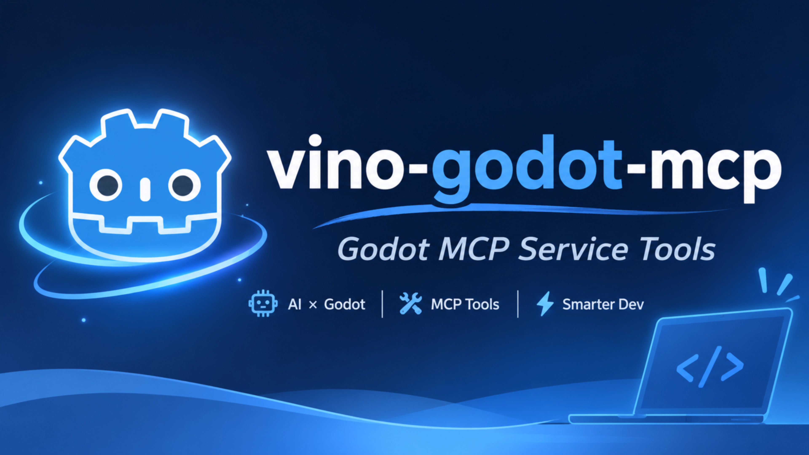

# Vino Godot MCP

> Internal project name: `vino-godot-mcp` · Maintained by **Vino Studios**



[](https://www.npmjs.com/package/vino-godot-mcp)
[](https://godotengine.org/)
[](https://modelcontextprotocol.io/)
[](https://nodejs.org/)
[](https://www.typescriptlang.org/)
[](LICENSE)

**AI-oriented semantic operation MCP for Godot 4.6.3+**
The product goal is to let an agent understand, inspect, create, modify, organize, and validate Godot scenes, nodes, signals, groups, resources, and project settings.
The current implementation provides a safe offline file channel plus a **read-only** Editor Bridge for live editor state; an authoritative Godot-native **write** channel is the next architectural milestone.
Runtime Adapter only calls Godot CLI when engine-dependent capabilities are required.

---

**Language / 语言**  
### [English](#english) & [中文](#中文)

---

<a id="english"></a>

## English

### Core Features

1. **Godot semantic operations (product direction)**
   Scene/node structure, signal/group relationships, resources, project settings, scripts, shaders, and validation are the primary domains. The native bridge design and current boundaries are documented in [`docs/GODOT_NATIVE_BRIDGE.md`](docs/GODOT_NATIVE_BRIDGE.md).

2. **Lossless Round-trip Parsing**
   The core parser strictly preserves unmodified content, comments, whitespace, `sub_resource`, `ext_resource`, and `UID` identifiers when reading and modifying Godot text resources.

3. **Background Auto-Management**
   Based on the standard MCP (Model Context Protocol). Once configured in an AI client, the client automatically starts and manages the Node.js process in the background. No manual terminal launch required.

4. **Natural Language = Godot Development Control**
   After setup, simply chat with the AI (e.g. “Read the current project config and parse the main scene tree”). The AI will automatically operate the project through MCP tools.

### Scene-First Development

Vino Godot MCP follows a **Scene-First** policy: a Godot project keeps its structure in native scenes, not in code that rebuilds it at runtime.

- `.tscn` — scene structure, node hierarchy, node properties, resource references and fixed signal connections.
- `.gd` — business logic, state management, algorithms and dynamic behavior.
- `.tres` — reusable resources, configuration and data.
- Shaders — materials and rendering logic.

Create nodes at runtime only for content that is genuinely dynamic.

| Case | Preferred form |
|---|---|
| Main menu UI, HUD, fixed level layout | `.tscn` nodes |
| Fixed signal wiring | `.tscn` `[connection]` (via `scene_connect_signal`) |
| Player movement, combat, algorithms | `.gd` |
| Spawned enemies, procedural maps, object pools, dynamic list UI | `.gd` at runtime |

Tools follow the same split: `scene_add_node`, `scene_add_visual_node`, `scene_set_ui_layout`, `scene_update_node_property` and `scene_connect_signal` write the scene; `script_create` and `script_update_function` write logic. A new scene starts from a minimal `[gd_scene format=3]` bootstrap written with `script_create`, then its nodes are added with the scene tools — `scene_create` is not part of this version.

### Editor Bridge (read-only)

`editor_get_scene`, `editor_get_tree`, `editor_get_node`, `editor_get_layout` and `project_capabilities` read the scene that is **currently open in a running Godot Editor** through an EditorPlugin + localhost TCP bridge. They need the addon in `godot_test/addons/vino-godot-mcp/` enabled in that project and a running Editor; otherwise they fail with `BRIDGE_UNAVAILABLE` / `BRIDGE_DISCONNECTED`.

What the bridge does **not** do: it does not create, modify, save, undo/redo, or otherwise write Godot objects. All scene/resource writes still go through the TypeScript parser + safe file write channel (`dryRun`, `expectedHash`, protected paths), and the engine-native write channel is **not implemented**. See [`docs/GODOT_NATIVE_BRIDGE.md`](docs/GODOT_NATIVE_BRIDGE.md).

### Install from npm (recommended)

Requires Node.js >= 22.

The npm package, the CLI command and the MCP server name are all `vino-godot-mcp` — one name to remember:

| Thing | Value |
|---|---|
| npm package (what you install) | `vino-godot-mcp` |
| CLI command (what you run) | `vino-godot-mcp` — from the `bin` field in `package.json` |
| MCP server name (what `initialize` reports) | `vino-godot-mcp` |

**Option 1 — install into a project (local):**

```bash
npm i vino-godot-mcp
```

Expected output (package counts and timings vary by environment; no error means success):

```text
$ npm i vino-godot-mcp

added 4 packages, and audited 5 packages in 5s

1 package is looking for funding
  run `npm fund` for details

found 0 vulnerabilities
```

**Option 2 — install globally (puts the `vino-godot-mcp` command on your PATH):**

```bash
npm i -g vino-godot-mcp
```

> `npm i -g` writes **nothing** into the current directory. Files go to the global prefix: on Windows `%APPDATA%\npm\node_modules\vino-godot-mcp`, with launchers `%APPDATA%\npm\vino-godot-mcp.cmd` and `.ps1`. A still-empty project folder does not mean the install failed.

**Option 3 — run once without installing:**

```bash
npx -y vino-godot-mcp
```

`npx` resolves the *package* name; a global install puts the same `vino-godot-mcp` command on your `PATH`.

#### Verify the installation (Windows)

```powershell
npm ls -g --depth=0 vino-godot-mcp   # registered globally?
where.exe vino-godot-mcp               # launcher on PATH?
vino-godot-mcp --version               # -> vino-godot-mcp 1.2.2
vino-godot-mcp --help                  # usage, plus the stdio note below
```

`--version` and `--help` print to stdout and exit immediately; they never start the server, so they are safe smoke tests. Both read the version from `package.json`.

#### Why the server "hangs" when you run it by hand

Without arguments the process starts a **stdio MCP server** and logs

```text
[vino-godot-mcp] INFO MCP server "vino-godot-mcp@1.2.2" listening on stdio, 61 tools exposed
```

to stderr, then waits for JSON-RPC on stdin (Ctrl+C to quit). One log line and then nothing visible is the expected behaviour, not a hang — only an MCP client speaks to it. Logs always go to stderr; stdout is reserved for the protocol. The count above is the `full` preset (everything in `src/tools/index.ts`); narrower presets and `VINO_GODOT_MCP_GROUPS` expose fewer tools. You normally never run it by hand — your AI client launches it after the configuration below.

### MCP Client Configuration (npm)

Add this to your AI client's MCP config (`.cursor/mcp.json`, CodeBuddy, Cline, …):

```json
{
  "mcpServers": {
    "vino-godot-mcp": {
      "command": "npx",
      "args": ["-y", "vino-godot-mcp"],
      "env": {
        "GODOT_PATH": "<absolute path to the Godot console executable>",
        "VINO_GODOT_MCP_LOG": "debug"
      }
    }
  }
}
```

> If you installed globally, skip `npx`: use `"command": "vino-godot-mcp"` and drop `args`. Both forms launch the same stdio server.

| Environment variable | Required | Meaning |
|---|---|---|
| `GODOT_PATH` | only for `runtime_*` tools | Absolute path to the Godot CLI. Tried first, `PATH` second (`src/godot/cli.ts`). A non-existent path fails loudly with `GODOT_NOT_FOUND` instead of silently falling back. |
| `VINO_GODOT_MCP_PRESET` | no | Which dependency range to expose: `default` / `runtime` / `editor` / `full` (`src/mcp/registry/toolSelection.ts`). When unset it is `default`, unless `VINO_GODOT_MCP_GROUPS` is set — then no dependency filter is applied (pre-P1-C behaviour). Unknown values fail at startup with `INVALID_CONFIGURATION`. |
| `VINO_GODOT_MCP_GROUPS` | no | Comma-separated domain filter exposing fewer tools, e.g. `project,shader`. Empty/unset means "no domain filter", unchanged from before (`src/mcp/registry/toolSelection.ts`). Unknown domains fail with `INVALID_CONFIGURATION`. |
| `VINO_GODOT_MCP_LOG` | no | `debug` / `info` / `warn` / `error`; default `info` (`src/core/logger.ts`). |

#### Tool presets and filtering

Tools are filtered **before** they are registered, so an excluded tool is simply absent from `tools/list` (no dynamic `listChanged`). The exposed set is:

```text
exposed = preset (dependency range) ∩ groups (domain range)
```

| preset | dependencies | what it is for |
|---|---|---|
| `default` | `none` | Node + project files only: parse/patch `.tscn`/`.tres`/`.gd`, read project settings. Works with no Godot installed and no editor open. |
| `runtime` | `none` + `godot` | adds everything that runs or probes the Godot engine (headless runs, ClassDB dump, project validation, runtime sessions). |
| `editor` | `none` + `bridge` | adds the live Editor Bridge readers (`editor_*`, `project_capabilities`). |
| `full` | `none` + `godot` + `bridge` | everything the build can do. |

```json
"env": {
  "VINO_GODOT_MCP_PRESET": "editor",
  "VINO_GODOT_MCP_GROUPS": "project,scene"
}
```

- `preset` and `groups` are independent: a preset never adds a domain, a group never adds a dependency. Their intersection is what you get.
- Both variable names and group names are trimmed and case-insensitive (`PRESET=RUNTIME`, `GROUPS=" Scene , Shader "` both work).
- `runtimeRequired` is **not** used for filtering; it is only a legacy "starts a Runtime Adapter" hint.
- The effective selection is logged at `INFO` on startup (stderr), e.g. `tool selection: preset=full source=legacy-groups dependencies=none+godot+bridge groups=project,shader tools=9/59`.

**How the preset is chosen (backward compatible)**

| `VINO_GODOT_MCP_PRESET` | `VINO_GODOT_MCP_GROUPS` | Effective preset | Effect |
|---|---|---|---|
| unset | unset/empty | `default` | 37 file-level tools |
| unset | `project,shader` | `full` (source `legacy-groups`) | only groups are applied — **identical to pre-P1-C behaviour** |
| `runtime` | unset/empty | `runtime` | 54 tools |
| `editor` | `scene` | `editor` | strict intersection |

Migration examples:

```jsonc
// Old config (still works, unchanged): only GROUPS
{ "env": { "VINO_GODOT_MCP_GROUPS": "project,shader" } }        // 10 tools
// Same intent, now explicit and future-proof
{ "env": { "VINO_GODOT_MCP_PRESET": "full", "VINO_GODOT_MCP_GROUPS": "project,shader" } } // 10 tools
// Just the file-level subset (no Godot, no editor)
{ "env": { "VINO_GODOT_MCP_PRESET": "default", "VINO_GODOT_MCP_GROUPS": "project,shader" } } // 8 tools
```

- An unknown preset or group aborts startup with `INVALID_CONFIGURATION`; an intersection that exposes zero tools aborts with `TOOL_SELECTION_EMPTY` **plus the presets that would work**, e.g. `Fix: set VINO_GODOT_MCP_PRESET=runtime|full`. A groups-only config can never hit this, because it applies no dependency filter.
- Note that an explicit `PRESET` is always strict: `PRESET=default` + `GROUPS=runtime` fails, while leaving `PRESET` unset keeps the old behaviour.

> **Windows note**: if your client cannot find `npx`, use `"command": "npx.cmd"`, or `"command": "cmd"` with `"args": ["/c", "npx", "-y", "vino-godot-mcp"]`.

> **🔴 Recommended**: using the console version of Godot is recommended, as it significantly improves AI operational efficiency.

### Usage

Once configured, just talk to your AI in natural language:

| What you say | Tool the AI calls |
|---|---|
| “Which Godot version does the CLI report?” | `runtime_get_version` |
| “Read `res://project.godot` and show the main scene and renderer settings.” | `project_get_config` |
| “Print the node tree of `res://main.tscn`.” | `scene_get_tree` |
| “In `res://player.tscn`, set `Sprite2D.position` to `Vector2(32, 64)`.” | `scene_update_node_property` |
| “Run the project and capture a screenshot.” | `runtime_run_project` + `runtime_capture_screenshot` |

Every write tool accepts two safety switches (see `src/tools/scene/updateNodeProperty.ts` and its siblings):

- `dryRun: true` — return the unified diff **without writing**.
- `expectedHash: "<sha256>"` — optimistic concurrency: if the file changed after the hash was read, the call fails with `FILE_CHANGED` instead of overwriting.

Typical safe-edit loop: a read tool (`scene_get_tree`, `project_get_config`, …) returns the current file hash → call the write tool with `dryRun: true` and review the diff → repeat without `dryRun`, passing `expectedHash`.

### Quick Start from Source (contributors)

```bash
# Install & Build
npm install
npm run build
# Output: dist/src/index.js
```

```bash
# Run all unit + Stdio e2e tests
npm test

# Debug CLI (without MCP client)
node dist/src/dev-cli.js list
node dist/src/dev-cli.js call utility_ping '{"echo":"heartbeat"}'
```

Local-build client config (instead of `npx`):

```json
{
  "mcpServers": {
    "vino-godot-mcp": {
      "command": "node",
      "args": [
        "D:/Dev/vino-godot-mcp/dist/src/index.js"
      ],
      "env": {
        "GODOT_PATH": "E:/Program Files/Godot Engine/Godot_v4.6.3-stable_win64.exe/Godot_v4.6.3-stable_win64_console.exe",
        "VINO_GODOT_MCP_LOG": "debug"
      }
    }
  }
}
```

> **⚠️ Note**: Please replace the path with the actual absolute path on your local machine.

### Current Status & Verified Capabilities

| Stage | Description | Status |
|-------|-------------|--------|
| Stage 1 | MCP Server foundation + Stdio communication | Completed |
| Stage 2 | Core parsers, Scene/Resource services, FileService | Completed |
| Stage 3 | Project config + GDScript/Shader management | Completed |

**Tool Matrix**

The single source of truth is `allTools` in `src/tools/index.ts`; the startup log and `vino-godot-mcp --help` report the live count, and `VINO_GODOT_MCP_PRESET` + `VINO_GODOT_MCP_GROUPS` can expose a subset. No count is duplicated here; the table lists every tool the build defines, regardless of the preset in use.

Runtime and editor tools are **not exposed by the default preset**: they require `VINO_GODOT_MCP_PRESET=runtime` or `editor` (or `full`). The same applies to every other `dependency: "godot"` tool (`class_*`, `scene_get_node_info`, `project_validate`) and `dependency: "bridge"` tool (`editor_*`, `project_capabilities`). Tool descriptions that point at `runtime_inspect_ui` say so explicitly.

| Domain | Tools |
|--------|-------|
| Utility | `utility_ping`, `utility_task_status` |
| Runtime | `runtime_get_version`, `runtime_run_project`, `runtime_run_scene`, `runtime_export_project`, `runtime_capture_screenshot`, `runtime_inspect_ui`, `runtime_check_addon_status`, `runtime_visual_debug`, `runtime_start_session`, `runtime_get_session`, `runtime_read_session_logs`, `runtime_stop_session` |
| Project | `project_capabilities`, `project_get_config`, `project_set_config`, `project_validate`, `project_apply_changes`, `project_check_changes`, `project_input_get`, `project_input_update` |
| Editor (read-only) | `editor_get_scene`, `editor_get_tree`, `editor_get_node`, `editor_get_layout` — require the Editor addon plus a running Godot Editor |
| Scene | `scene_get_tree`, `scene_get_node_info`, `scene_find_nodes`, `scene_add_visual_node`, `scene_set_ui_layout`, `scene_get_connections`, `scene_analyze_connections`, `scene_update_signal_connection`, `scene_update_node_property`, `scene_remove_node`, `scene_add_node`, `scene_reparent_node`, `scene_add_to_group`, `scene_remove_from_group`, `scene_instantiate_scene`, `scene_connect_signal`, `scene_disconnect_signal` |
| Resource | `resource_get_info`, `resource_update_property`, `resource_add_or_update_external`, `resource_check_uid` |
| Shader | `shader_get_info`, `shader_update_uniform_default` |
| Script | `script_get_info`, `script_update_export_default`, `script_create`, `script_analyze`, `script_find_references`, `script_update_function`, `script_project_graph` |
| Class | `class_get_info`, `class_search`, `class_validate_member` |
| Asset | `asset_list`, `asset_get_info` |

> Tools that need authoritative class info (`class_get_info`, `class_search`, `class_validate_member`, `scene_get_node_info`) cache the engine's ClassDB API dump under `<projectRoot>/.vino-godot-mcp/` (keyed by engine version) — add that folder to your project's `.gitignore`; the server never edits your `.gitignore`. Because the first call starts `godot --headless --dump-extension-api` and writes that cache, these tools are advertised with `readOnlyHint: false` even though they never modify project content. The same applies to `project_validate` and `runtime_visual_debug`, which execute project code.

### Architecture & Documentation

Strict unidirectional dependency:

```
MCP Layer → Tool Layer → Service Layer → Core/Parser → FileSystem
```

| Document | Description |
|----------|-------------|
| `docs/GODOT_NATIVE_BRIDGE.md` | Native read-only Editor Bridge: framing, boundaries, and the not-yet-implemented write channel |

### Contact

| Channel | Link |
|---|---|
| GitHub | https://github.com/vino3dx |
| Blog | https://vinofx.com/ |
| Email | vino3dx@gmail.com |
| Bilibili | https://space.bilibili.com/250546761?spm_id_from=333.1007.0.0 |

---

<a id="中文"></a>

## 中文

### 核心特性

1. **直读直写与无损解析（Round-trip）**  
   核心解析器保证在对 Godot 文本资源进行读取与修改时，未修改的部分、注释、格式空格以及 `sub_resource` / `ext_resource` / `UID` 标识会被严格原样保留。

2. **后台自动化托管（无需手动启动）**  
   基于标准 MCP（Model Context Protocol）协议。配置到 AI 客户端后，客户端会在后台自动拉起并常驻管理 Node.js 服务进程，无需在终端手动运行。

3. **自然语言对话即操作**  
   配置完成后，直接在 AI 客户端聊天框中使用自然语言下发指令（例如：“帮我读取当前项目的配置并解析主场景树”），AI 会自动通过 MCP 操控项目。

### 场景优先开发（Scene-First Development）

Vino Godot MCP 遵循 **Scene-First（场景优先）** 原则：Godot 工程的结构保存在原生场景中，而不是在运行时重建它的代码里。

- `.tscn`：场景结构、节点层级、节点属性、资源引用与固定信号连接。
- `.gd`：业务逻辑、状态管理、算法与动态行为。
- `.tres`：可复用资源、配置与数据。
- Shader：材质与渲染逻辑。

只有内容确实需要动态生成时，才在运行时创建节点。

| 场景 | 推荐形式 |
|---|---|
| 主菜单 UI、HUD、固定关卡结构 | `.tscn` 节点 |
| 固定信号连接 | `.tscn` `[connection]`（通过 `scene_connect_signal`） |
| 玩家移动、战斗、算法 | `.gd` |
| 动态生成敌人、程序化地图、对象池、动态列表 UI | 运行时由 `.gd` 创建 |

工具遵循同一分工：`scene_add_node`、`scene_add_visual_node`、`scene_set_ui_layout`、`scene_update_node_property`、`scene_connect_signal` 写场景；`script_create`、`script_update_function` 写逻辑。新场景先用 `script_create` 写最小 `[gd_scene format=3]` 引导骨架，再用场景工具添加节点；`scene_create` 不属于本版本。

### 编辑器桥（只读）

`editor_get_scene`、`editor_get_tree`、`editor_get_node`、`editor_get_layout` 与 `project_capabilities` 通过 EditorPlugin + 本地 TCP 桥读取**正在运行的 Godot 编辑器中当前打开的场景**。使用前提是该工程启用了 `godot_test/addons/vino-godot-mcp/` 插件并开着编辑器，否则返回 `BRIDGE_UNAVAILABLE` / `BRIDGE_DISCONNECTED`。

这个桥**不做**什么：不创建、不修改、不保存、不进 Undo/Redo，也不写任何 Godot 对象。所有场景/资源写入仍然走 TypeScript 解析器 + 安全文件写入通道（`dryRun`、`expectedHash`、受保护路径），引擎原生写入通道**尚未实现**。详见 [`docs/GODOT_NATIVE_BRIDGE.md`](docs/GODOT_NATIVE_BRIDGE.md)。

### 从 npm 安装（推荐）

需要 Node.js >= 22。

npm 包名、CLI 命令名与 MCP 服务名统一为 `vino-godot-mcp`，只需记一个名字：

| 对象 | 值 |
|---|---|
| npm 包名（安装什么） | `vino-godot-mcp` |
| CLI 命令名（运行什么） | `vino-godot-mcp` —— 来自 `package.json` 的 `bin` 字段 |
| MCP 服务名（`initialize` 上报的名字） | `vino-godot-mcp` |

**方式一 —— 安装到项目（本地）：**

```bash
npm i vino-godot-mcp
```

预期输出（包数量与耗时随环境不同，无报错即成功）：

```text
$ npm i vino-godot-mcp

added 4 packages, and audited 5 packages in 5s

1 package is looking for funding
  run `npm fund` for details

found 0 vulnerabilities
```

**方式二 —— 全局安装（把 `vino-godot-mcp` 命令放进 PATH）：**

```bash
npm i -g vino-godot-mcp
```

> `npm i -g` **不会**往当前目录写任何文件。包会落在全局前缀：Windows 上是 `%APPDATA%\npm\node_modules\vino-godot-mcp`，并生成启动脚本 `%APPDATA%\npm\vino-godot-mcp.cmd` 与 `.ps1`。所以当前项目目录仍然是空的，不代表安装失败。

**方式三 —— 不安装，直接运行一次：**

```bash
npx -y vino-godot-mcp
```

`npx` 解析的是*包名*；全局安装后得到的命令是 `vino-godot-mcp`。

#### 安装验证（Windows）

```powershell
npm ls -g --depth=0 vino-godot-mcp   # 全局是否已登记？
where.exe vino-godot-mcp               # 启动脚本是否在 PATH 上？
vino-godot-mcp --version               # 输出：vino-godot-mcp 1.2.2
vino-godot-mcp --help                  # 用法说明 + 下面的 stdio 提示
```

`--version` 与 `--help` 输出到 stdout 后立即退出，不会启动服务，可以放心当作自检命令；版本号从 `package.json` 读取。

#### 为什么手动运行时会“卡住”

不带参数时启动的是 **stdio MCP 服务**，它先往 stderr 打

```text
[vino-godot-mcp] INFO MCP server "vino-godot-mcp@1.2.2" listening on stdio, 61 tools exposed
```

然后阻塞等待 stdin 上的 JSON-RPC 消息（Ctrl+C 退出）。只打一行日志然后没反应是**正常行为**，不是卡死 —— 只有 MCP 客户端才会和它对话。日志一律走 stderr，stdout 专供协议使用。上面这个数量对应 `full` 预设（`src/tools/index.ts` 的全部工具）；更窄的预设与 `VINO_GODOT_MCP_GROUPS` 会暴露更少的工具。通常你不需要手动运行它 —— AI 客户端在完成下面的配置后会自己拉起。

### 在 AI 客户端中配置（npm）

在 AI 客户端（如 Cursor、CodeBuddy、Cline 等）的 MCP 配置文件中添加：

```json
{
  "mcpServers": {
    "vino-godot-mcp": {
      "command": "npx",
      "args": ["-y", "vino-godot-mcp"],
      "env": {
        "GODOT_PATH": "<你的 Godot 控制台版可执行文件的绝对路径>",
        "VINO_GODOT_MCP_LOG": "debug"
      }
    }
  }
}
```

> 如果已经全局安装，可以不用 `npx`：把 `"command"` 改成 `"vino-godot-mcp"` 并删掉 `args`。两种写法拉起的是同一个 stdio 服务。

| 环境变量 | 是否必需 | 说明 |
|---|---|---|
| `GODOT_PATH` | 仅 `runtime_*` 类工具需要 | Godot CLI 的绝对路径。优先读取它，其次在 `PATH` 中查找（`src/godot/cli.ts`）。路径不存在时会直接报 `GODOT_NOT_FOUND`，不会静默回退到 `PATH`。 |
| `VINO_GODOT_MCP_PRESET` | 否 | 按依赖范围暴露工具：`default` / `runtime` / `editor` / `full`（`src/mcp/registry/toolSelection.ts`）。未设置时取 `default`；但如果设置了 `VINO_GODOT_MCP_GROUPS`，则不按依赖过滤（保持 P1-C 之前的旧行为）。未知取值在启动时直接报 `INVALID_CONFIGURATION`。 |
| `VINO_GODOT_MCP_GROUPS` | 否 | 逗号分隔的领域过滤，只向客户端暴露部分工具，例如 `project,shader`。空值/未设置表示不按领域过滤（与旧行为一致）（`src/mcp/registry/toolSelection.ts`）。未知领域会报 `INVALID_CONFIGURATION`。 |
| `VINO_GODOT_MCP_LOG` | 否 | `debug` / `info` / `warn` / `error`，默认 `info`（`src/core/logger.ts`）。 |

#### 工具预设与筛选

筛选发生在工具注册**之前**：被排除的工具根本不会出现在 `tools/list` 里（没有动态 `listChanged`）。暴露集合为：

```text
暴露工具 = 预设（依赖范围） ∩ 分组（领域范围）
```

| preset | 依赖 | 适用场景 |
|---|---|---|
| `default` | `none` | 只用 Node 与工程文件：解析/改写 `.tscn`/`.tres`/`.gd`、读取项目设置。不需要安装 Godot，也不需要打开编辑器。 |
| `runtime` | `none` + `godot` | 追加所有需要运行或探测 Godot 引擎的工具（headless 运行、ClassDB dump、工程校验、运行时会话）。 |
| `editor` | `none` + `bridge` | 追加读取运行中编辑器的工具（`editor_*`、`project_capabilities`）。 |
| `full` | `none` + `godot` + `bridge` | 本版本支持的全部工具。 |

```json
"env": {
  "VINO_GODOT_MCP_PRESET": "editor",
  "VINO_GODOT_MCP_GROUPS": "project,scene"
}
```

- `preset` 与 `groups` 是两个正交维度：预设不会增加领域，分组也不会增加依赖，取交集。
- 变量名与分组名都会 trim 且忽略大小写（`PRESET=RUNTIME`、`GROUPS=" Scene , Shader "` 都有效）。
- `runtimeRequired` 不参与筛选，它只是"是否通过 Runtime Adapter 启动进程"的历史提示。
- 生效结果会在启动时以 `INFO` 打到 stderr，例如 `tool selection: preset=full source=legacy-groups dependencies=none+godot+bridge groups=project,shader tools=9/59`。

**预设的选择规则（向后兼容旧配置）**

| `VINO_GODOT_MCP_PRESET` | `VINO_GODOT_MCP_GROUPS` | 生效预设 | 效果 |
|---|---|---|---|
| 未设置 | 未设置/空 | `default` | 37 个文件级工具 |
| 未设置 | `project,shader` | `full`（source `legacy-groups`） | 只按分组过滤，**与 P1-C 之前完全一致** |
| `runtime` | 未设置/空 | `runtime` | 54 个工具 |
| `editor` | `scene` | `editor` | 严格取交集 |

迁移示例：

```jsonc
// 旧配置（继续可用，行为不变）：只写 GROUPS
{ "env": { "VINO_GODOT_MCP_GROUPS": "project,shader" } }        // 10 个工具
// 同样效果，但改成显式写法，未来更可控
{ "env": { "VINO_GODOT_MCP_PRESET": "full", "VINO_GODOT_MCP_GROUPS": "project,shader" } } // 10 个工具
// 只要文件级子集（不碰 Godot，也不碰编辑器）
{ "env": { "VINO_GODOT_MCP_PRESET": "default", "VINO_GODOT_MCP_GROUPS": "project,shader" } } // 8 个工具
```

- 未知预设/未知分组会在启动时报 `INVALID_CONFIGURATION`；交集为空报 `TOOL_SELECTION_EMPTY`，并直接给出**能用的预设**（例如 `Fix: set VINO_GODOT_MCP_PRESET=runtime|full`）。只写 `GROUPS` 的旧配置不会触发该错误，因为它不做依赖过滤。
- 注意：显式写了 `PRESET` 就一定严格执行筛选，`PRESET=default` + `GROUPS=runtime` 会失败；不写 `PRESET` 才保持旧行为。

> **Windows 提示**：如果客户端找不到 `npx`，可改为 `"command": "npx.cmd"`，或用 `"command": "cmd"` 搭配 `"args": ["/c", "npx", "-y", "vino-godot-mcp"]`。

> **🔴 推荐**：建议使用控制台（Console）版本的 Godot，能显著提升 AI 操作效率。

### 用法

配置完成后，直接用自然语言对 AI 下指令即可：

| 你可以这样说 | AI 实际调用的工具 |
|---|---|
| “CLI 报告的 Godot 版本是多少？” | `runtime_get_version` |
| “读取 `res://project.godot`，告诉我主场景和渲染设置。” | `project_get_config` |
| “打印 `res://main.tscn` 的节点树。” | `scene_get_tree` |
| “把 `res://player.tscn` 里 `Sprite2D.position` 改成 `Vector2(32, 64)`。” | `scene_update_node_property` |
| “运行项目并截一张图。” | `runtime_run_project` + `runtime_capture_screenshot` |

所有写操作类工具都支持两个安全开关（见 `src/tools/scene/updateNodeProperty.ts` 及其同类文件）：

- `dryRun: true` —— 只返回 unified diff，**不落盘**。
- `expectedHash: "<sha256>"` —— 乐观并发：若文件在读取hash 之后被改动，调用会以 `FILE_CHANGED` 失败，而不是覆盖别人的修改。

推荐的安全编辑闭环：先用读类工具（`scene_get_tree`、`project_get_config` 等）拿到当前文件 hash → 用 `dryRun: true` 调写工具看 diff → 去掉 `dryRun` 并带上 `expectedHash` 再调一次。

### 从源码启动（贡献者）

```bash
# 安装与编译
npm install
npm run build
# 输出目录：dist/src/index.js
```

```bash
# 运行全部单元测试与 Stdio 端到端集成测试
npm test

# 内置调试 CLI（不经 MCP 客户端）
node dist/src/dev-cli.js list
node dist/src/dev-cli.js call utility_ping '{"echo":"heartbeat"}'
```

使用本地构建产物时的客户端配置（替代 `npx`）：

```json
{
  "mcpServers": {
    "vino-godot-mcp": {
      "command": "node",
      "args": [
        "D:/Dev/vino-godot-mcp/dist/src/index.js"
      ],
      "env": {
        "GODOT_PATH": "E:/Program Files/Godot Engine/Godot_v4.6.3-stable_win64.exe/Godot_v4.6.3-stable_win64_console.exe",
        "VINO_GODOT_MCP_LOG": "debug"
      }
    }
  }
}
```

> **⚠️ 注意**：请将路径替换为你本机的实际绝对路径。

### 当前状态与已验证能力

| 阶段 | 描述 | 状态 |
|------|------|------|
| Stage 1 | MCP 服务端基础 + Stdio 通信架构 | 已完成 |
| Stage 2 | 核心解析器、Scene/Resource 服务、FileService | 已完成 |
| Stage 3 | 项目配置 + GDScript/Shader 管理 | 已完成 |

**当前工具矩阵**

唯一来源是 `src/tools/index.ts` 的 `allTools`；启动日志与 `vino-godot-mcp --help` 会报告实时数量，`VINO_GODOT_MCP_PRESET` 与 `VINO_GODOT_MCP_GROUPS` 可只暴露其中一部分。此处不再重复硬编码数量；下表列出的是本版本定义的全部工具，与实际启用哪个预设无关。

Runtime 与 editor 工具**不在默认预设中**：需要设置 `VINO_GODOT_MCP_PRESET=runtime` 或 `editor`（或 `full`）。所有 `dependency: "godot"` 的工具（`class_*`、`scene_get_node_info`、`project_validate`）与 `dependency: "bridge"` 的工具（`editor_*`、`project_capabilities`）同理。指向 `runtime_inspect_ui` 的工具描述会明确标注这一点。

| 领域 | 工具 |
|------|------|
| Utility | `utility_ping`、`utility_task_status` |
| Runtime | `runtime_get_version`、`runtime_run_project`、`runtime_run_scene`、`runtime_export_project`、`runtime_capture_screenshot`、`runtime_inspect_ui`、`runtime_check_addon_status`、`runtime_visual_debug`、`runtime_start_session`、`runtime_get_session`、`runtime_read_session_logs`、`runtime_stop_session` |
| Project | `project_capabilities`、`project_get_config`、`project_set_config`、`project_validate`、`project_apply_changes`、`project_check_changes`、`project_input_get`、`project_input_update` |
| Editor（只读） | `editor_get_scene`、`editor_get_tree`、`editor_get_node`、`editor_get_layout` —— 需要启用编辑器插件并保持 Godot 编辑器运行 |
| Scene | `scene_get_tree`、`scene_get_node_info`、`scene_find_nodes`、`scene_add_visual_node`、`scene_set_ui_layout`、`scene_get_connections`、`scene_analyze_connections`、`scene_update_signal_connection`、`scene_update_node_property`、`scene_remove_node`、`scene_add_node`、`scene_reparent_node`、`scene_add_to_group`、`scene_remove_from_group`、`scene_instantiate_scene`、`scene_connect_signal`、`scene_disconnect_signal` |
| Resource | `resource_get_info`、`resource_update_property`、`resource_add_or_update_external`、`resource_check_uid` |
| Shader | `shader_get_info`、`shader_update_uniform_default` |
| Script | `script_get_info`、`script_update_export_default`、`script_create`、`script_analyze`、`script_find_references`、`script_update_function`、`script_project_graph` |
| Class | `class_get_info`、`class_search`、`class_validate_member` |
| Asset | `asset_list`、`asset_get_info` |

> 需要权威类信息的工具（`class_get_info`、`class_search`、`class_validate_member`、`scene_get_node_info`）会把引擎导出的 ClassDB API dump 缓存到 `<被操作工程根>/.vino-godot-mcp/`（按引擎版本分键）—— 建议把该目录加进你工程的 `.gitignore`；本服务不会自动修改你的 `.gitignore`。由于首次调用会启动 `godot --headless --dump-extension-api` 并写入该缓存，这些工具的注解是 `readOnlyHint: false`，尽管它们不修改工程内容。`project_validate` 与 `runtime_visual_debug` 同理，因为它们会执行工程代码。

### 项目架构与文档

严格遵循单向依赖架构：

```
MCP Layer → Tool Layer → Service Layer → Core/Parser → FileSystem
```

| 文档 | 说明 |
|------|------|
| `docs/GODOT_NATIVE_BRIDGE.md` | 原生只读编辑器桥：通信帧格式、能力边界、尚未实现的写入通道 |

### 联系方式

| 渠道 | 地址 |
|---|---|
| GitHub | https://github.com/vino3dx |
| 博客 | https://vinofx.com/ |
| 邮箱 | vino3dx@gmail.com |
| 哔哩哔哩 | https://space.bilibili.com/250546761?spm_id_from=333.1007.0.0 |

---

## License

MIT
