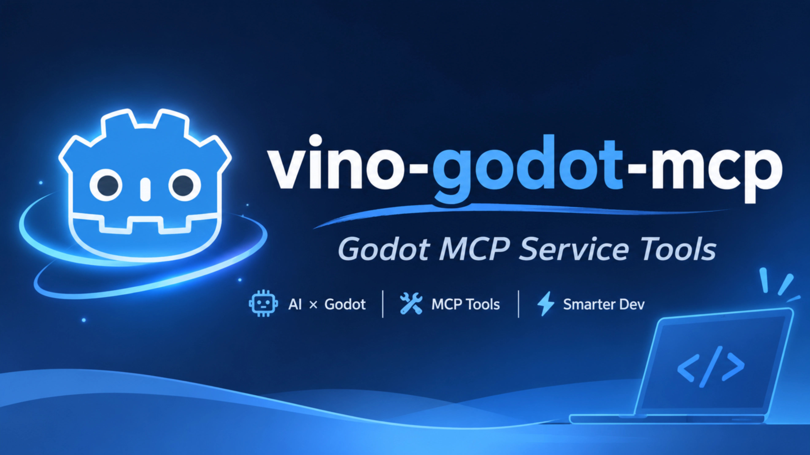

# Vino Godot MCP

> Internal project name: `vino-godot-mcp` · Maintained by **Vino Studios**



[](https://www.npmjs.com/package/vino-godot-mcp)
[](https://godotengine.org/)
[](https://modelcontextprotocol.io/)
[](https://nodejs.org/)
[](https://www.typescriptlang.org/)
[](LICENSE)

**AI-oriented semantic operation MCP for Godot 4.6.3+**
The product goal is to let an agent understand, inspect, create, modify, organize, and validate Godot scenes, nodes, signals, groups, resources, and project settings.
The current implementation provides a safe offline file channel; an authoritative Godot-native object bridge is the next architectural milestone.
Runtime Adapter only calls Godot CLI when engine-dependent capabilities are required.

---

**Language / 语言**  
### [English](#english) & [中文](#中文)

---

<a id="english"></a>

## English

### Core Features

1. **Godot semantic operations (product direction)**
   Scene/node structure, signal/group relationships, resources, project settings, scripts, shaders, and validation are the primary domains. The native bridge design and current boundaries are documented in [`docs/GODOT_NATIVE_BRIDGE.md`](docs/GODOT_NATIVE_BRIDGE.md).

2. **Lossless Round-trip Parsing**
   The core parser strictly preserves unmodified content, comments, whitespace, `sub_resource`, `ext_resource`, and `UID` identifiers when reading and modifying Godot text resources.

3. **Background Auto-Management**
   Based on the standard MCP (Model Context Protocol). Once configured in an AI client, the client automatically starts and manages the Node.js process in the background. No manual terminal launch required.

4. **Natural Language = Godot Development Control**
   After setup, simply chat with the AI (e.g. “Read the current project config and parse the main scene tree”). The AI will automatically operate the project through MCP tools.

### Install from npm (recommended)

Requires Node.js >= 22.

The npm package, the CLI command and the MCP server name are all `vino-godot-mcp` — one name to remember:

| Thing | Value |
|---|---|
| npm package (what you install) | `vino-godot-mcp` |
| CLI command (what you run) | `vino-godot-mcp` — from the `bin` field in `package.json` |
| MCP server name (what `initialize` reports) | `vino-godot-mcp` |

**Option 1 — install into a project (local):**

```bash
npm i vino-godot-mcp
```

Expected output (package counts and timings vary by environment; no error means success):

```text
$ npm i vino-godot-mcp

added 4 packages, and audited 5 packages in 5s

1 package is looking for funding
  run `npm fund` for details

found 0 vulnerabilities
```

**Option 2 — install globally (puts the `vino-godot-mcp` command on your PATH):**

```bash
npm i -g vino-godot-mcp
```

> `npm i -g` writes **nothing** into the current directory. Files go to the global prefix: on Windows `%APPDATA%\npm\node_modules\vino-godot-mcp`, with launchers `%APPDATA%\npm\vino-godot-mcp.cmd` and `.ps1`. A still-empty project folder does not mean the install failed.

**Option 3 — run once without installing:**

```bash
npx -y vino-godot-mcp
```

`npx` resolves the *package* name; a global install puts the same `vino-godot-mcp` command on your `PATH`.

#### Verify the installation (Windows)

```powershell
npm ls -g --depth=0 vino-godot-mcp   # registered globally?
where.exe vino-godot-mcp               # launcher on PATH?
vino-godot-mcp --version               # -> vino-godot-mcp 1.2.0
vino-godot-mcp --help                  # usage, plus the stdio note below
```

`--version` and `--help` print to stdout and exit immediately; they never start the server, so they are safe smoke tests. Both read the version from `package.json`.

#### Why the server "hangs" when you run it by hand

Without arguments the process starts a **stdio MCP server** and logs

```text
[vino-godot-mcp] INFO MCP server "vino-godot-mcp@1.2.0" listening on stdio, 55 tools exposed
```

to stderr, then waits for JSON-RPC on stdin (Ctrl+C to quit). One log line and then nothing visible is the expected behaviour, not a hang — only an MCP client speaks to it. Logs always go to stderr; stdout is reserved for the protocol. The tool count is whatever the registry (`src/tools/index.ts`) actually registered, and it is smaller when `VINO_GODOT_MCP_GROUPS` filters domains. You normally never run it by hand — your AI client launches it after the configuration below.

### MCP Client Configuration (npm)

Add this to your AI client's MCP config (`.cursor/mcp.json`, CodeBuddy, Cline, …):

```json
{
  "mcpServers": {
    "vino-godot-mcp": {
      "command": "npx",
      "args": ["-y", "vino-godot-mcp"],
      "env": {
        "GODOT_PATH": "<absolute path to the Godot console executable>",
        "VINO_GODOT_MCP_LOG": "debug"
      }
    }
  }
}
```

> If you installed globally, skip `npx`: use `"command": "vino-godot-mcp"` and drop `args`. Both forms launch the same stdio server.

| Environment variable | Required | Meaning |
|---|---|---|
| `GODOT_PATH` | only for `runtime_*` tools | Absolute path to the Godot CLI. Tried first, `PATH` second (`src/godot/cli.ts`). A non-existent path fails loudly with `GODOT_NOT_FOUND` instead of silently falling back. |
| `VINO_GODOT_MCP_GROUPS` | no | Comma-separated domain filter exposing fewer tools, e.g. `project,shader` (`src/mcp/registry/toolRegistry.ts`). |
| `VINO_GODOT_MCP_LOG` | no | `debug` / `info` / `warn` / `error`; default `info` (`src/core/logger.ts`). |

> **Windows note**: if your client cannot find `npx`, use `"command": "npx.cmd"`, or `"command": "cmd"` with `"args": ["/c", "npx", "-y", "vino-godot-mcp"]`.

> **🔴 Recommended**: using the console version of Godot is recommended, as it significantly improves AI operational efficiency.

### Usage

Once configured, just talk to your AI in natural language:

| What you say | Tool the AI calls |
|---|---|
| “Which Godot version does the CLI report?” | `runtime_get_version` |
| “Read `res://project.godot` and show the main scene and renderer settings.” | `project_get_config` |
| “Print the node tree of `res://main.tscn`.” | `scene_get_tree` |
| “In `res://player.tscn`, set `Sprite2D.position` to `Vector2(32, 64)`.” | `scene_update_node_property` |
| “Run the project and capture a screenshot.” | `runtime_run_project` + `runtime_capture_screenshot` |

Every write tool accepts two safety switches (see `src/tools/scene/updateNodeProperty.ts` and its siblings):

- `dryRun: true` — return the unified diff **without writing**.
- `expectedHash: "<sha256>"` — optimistic concurrency: if the file changed after the hash was read, the call fails with `FILE_CHANGED` instead of overwriting.

Typical safe-edit loop: a read tool (`scene_get_tree`, `project_get_config`, …) returns the current file hash → call the write tool with `dryRun: true` and review the diff → repeat without `dryRun`, passing `expectedHash`.

### Quick Start from Source (contributors)

```bash
# Install & Build
npm install
npm run build
# Output: dist/src/index.js
```

```bash
# Run all unit + Stdio e2e tests
npm test

# Debug CLI (without MCP client)
node dist/src/dev-cli.js list
node dist/src/dev-cli.js call utility_ping '{"echo":"heartbeat"}'
```

Local-build client config (instead of `npx`):

```json
{
  "mcpServers": {
    "vino-godot-mcp": {
      "command": "node",
      "args": [
        "D:/Dev/vino-godot-mcp/dist/src/index.js"
      ],
      "env": {
        "GODOT_PATH": "E:/Program Files/Godot Engine/Godot_v4.6.3-stable_win64.exe/Godot_v4.6.3-stable_win64_console.exe",
        "VINO_GODOT_MCP_LOG": "debug"
      }
    }
  }
}
```

> **⚠️ Note**: Please replace the path with the actual absolute path on your local machine.

### Current Status & Verified Capabilities

| Stage | Description | Status |
|-------|-------------|--------|
| Stage 1 | MCP Server foundation + Stdio communication | Completed |
| Stage 2 | Core parsers, Scene/Resource services, FileService | Completed |
| Stage 3 | Project config + GDScript/Shader management | Completed |

**Tool Matrix**

The single source of truth is `allTools` in `src/tools/index.ts`; the startup log and `vino-godot-mcp --help` report the live count, and `VINO_GODOT_MCP_GROUPS` can expose a subset (`project,shader`). No count is duplicated here.

| Domain | Tools |
|--------|-------|
| Utility | `utility_ping`, `utility_task_status` |
| Runtime | `runtime_get_version`, `runtime_run_project`, `runtime_run_scene`, `runtime_export_project`, `runtime_capture_screenshot`, `runtime_inspect_ui`, `runtime_check_addon_status`, `runtime_visual_debug`, `runtime_start_session`, `runtime_get_session`, `runtime_read_session_logs`, `runtime_stop_session` |
| Project | `project_capabilities`, `project_get_config`, `project_set_config`, `project_validate`, `project_apply_changes`, `project_input_get`, `project_input_update` |
| Scene | `scene_get_tree`, `scene_get_node_info`, `scene_find_nodes`, `scene_add_visual_node`, `scene_set_ui_layout`, `scene_get_connections`, `scene_analyze_connections`, `scene_update_signal_connection`, `scene_update_node_property`, `scene_remove_node`, `scene_add_node`, `scene_reparent_node`, `scene_add_to_group`, `scene_remove_from_group`, `scene_instantiate_scene`, `scene_connect_signal`, `scene_disconnect_signal` |
| Resource | `resource_get_info`, `resource_update_property`, `resource_add_or_update_external` |
| Shader | `shader_get_info`, `shader_update_uniform_default` |
| Script | `script_get_info`, `script_update_export_default`, `script_create`, `script_analyze`, `script_find_references`, `script_update_function`, `script_project_graph` |
| Class | `class_get_info`, `class_search`, `class_validate_member` |
| Asset | `asset_list`, `asset_get_info` |

> Tools that need authoritative class info (e.g. `scene_get_node_info`) cache the engine's ClassDB API dump under `<projectRoot>/.vino-godot-mcp/` (keyed by engine version) — add that folder to your project's `.gitignore`; the server never edits your `.gitignore`.

### Architecture & Documentation

Strict unidirectional dependency:

```
MCP Layer → Tool Layer → Service Layer → Core/Parser → FileSystem
```

| Document | Description |
|----------|-------------|
| `docs/HANDOFF.md` | Global handoff notes & progress |
| `docs/AGENTS.md` | Architecture rules & quality red lines |
| `docs/ARCHITECTURE.md` | Layered architecture & MCP protocol details |
| `docs/concurrency.md` | File locks & runtime queue design |

### Contact

| Channel | Link |
|---|---|
| GitHub | https://github.com/vino3dx |
| Blog | https://vinofx.com/ |
| Email | vino3dx@gmail.com |
| Bilibili | https://space.bilibili.com/250546761?spm_id_from=333.1007.0.0 |

---

<a id="中文"></a>

## 中文

### 核心特性

1. **直读直写与无损解析（Round-trip）**  
   核心解析器保证在对 Godot 文本资源进行读取与修改时，未修改的部分、注释、格式空格以及 `sub_resource` / `ext_resource` / `UID` 标识会被严格原样保留。

2. **后台自动化托管（无需手动启动）**  
   基于标准 MCP（Model Context Protocol）协议。配置到 AI 客户端后，客户端会在后台自动拉起并常驻管理 Node.js 服务进程，无需在终端手动运行。

3. **自然语言对话即操作**  
   配置完成后，直接在 AI 客户端聊天框中使用自然语言下发指令（例如：“帮我读取当前项目的配置并解析主场景树”），AI 会自动通过 MCP 操控项目。

### 从 npm 安装（推荐）

需要 Node.js >= 22。

npm 包名、CLI 命令名与 MCP 服务名统一为 `vino-godot-mcp`，只需记一个名字：

| 对象 | 值 |
|---|---|
| npm 包名（安装什么） | `vino-godot-mcp` |
| CLI 命令名（运行什么） | `vino-godot-mcp` —— 来自 `package.json` 的 `bin` 字段 |
| MCP 服务名（`initialize` 上报的名字） | `vino-godot-mcp` |

**方式一 —— 安装到项目（本地）：**

```bash
npm i vino-godot-mcp
```

预期输出（包数量与耗时随环境不同，无报错即成功）：

```text
$ npm i vino-godot-mcp

added 4 packages, and audited 5 packages in 5s

1 package is looking for funding
  run `npm fund` for details

found 0 vulnerabilities
```

**方式二 —— 全局安装（把 `vino-godot-mcp` 命令放进 PATH）：**

```bash
npm i -g vino-godot-mcp
```

> `npm i -g` **不会**往当前目录写任何文件。包会落在全局前缀：Windows 上是 `%APPDATA%\npm\node_modules\vino-godot-mcp`，并生成启动脚本 `%APPDATA%\npm\vino-godot-mcp.cmd` 与 `.ps1`。所以当前项目目录仍然是空的，不代表安装失败。

**方式三 —— 不安装，直接运行一次：**

```bash
npx -y vino-godot-mcp
```

`npx` 解析的是*包名*；全局安装后得到的命令是 `vino-godot-mcp`。

#### 安装验证（Windows）

```powershell
npm ls -g --depth=0 vino-godot-mcp   # 全局是否已登记？
where.exe vino-godot-mcp               # 启动脚本是否在 PATH 上？
vino-godot-mcp --version               # 输出：vino-godot-mcp 1.2.0
vino-godot-mcp --help                  # 用法说明 + 下面的 stdio 提示
```

`--version` 与 `--help` 输出到 stdout 后立即退出，不会启动服务，可以放心当作自检命令；版本号从 `package.json` 读取。

#### 为什么手动运行时会“卡住”

不带参数时启动的是 **stdio MCP 服务**，它先往 stderr 打

```text
[vino-godot-mcp] INFO MCP server "vino-godot-mcp@1.2.0" listening on stdio, 55 tools exposed
```

然后阻塞等待 stdin 上的 JSON-RPC 消息（Ctrl+C 退出）。只打一行日志然后没反应是**正常行为**，不是卡死 —— 只有 MCP 客户端才会和它对话。日志一律走 stderr，stdout 专供协议使用。工具数量取决于注册表（`src/tools/index.ts`）实际注册了多少，`VINO_GODOT_MCP_GROUPS` 过滤领域时会少于该数值。通常你不需要手动运行它 —— AI 客户端在完成下面的配置后会自己拉起。

### 在 AI 客户端中配置（npm）

在 AI 客户端（如 Cursor、CodeBuddy、Cline 等）的 MCP 配置文件中添加：

```json
{
  "mcpServers": {
    "vino-godot-mcp": {
      "command": "npx",
      "args": ["-y", "vino-godot-mcp"],
      "env": {
        "GODOT_PATH": "<你的 Godot 控制台版可执行文件的绝对路径>",
        "VINO_GODOT_MCP_LOG": "debug"
      }
    }
  }
}
```

> 如果已经全局安装，可以不用 `npx`：把 `"command"` 改成 `"vino-godot-mcp"` 并删掉 `args`。两种写法拉起的是同一个 stdio 服务。

| 环境变量 | 是否必需 | 说明 |
|---|---|---|
| `GODOT_PATH` | 仅 `runtime_*` 类工具需要 | Godot CLI 的绝对路径。优先读取它，其次在 `PATH` 中查找（`src/godot/cli.ts`）。路径不存在时会直接报 `GODOT_NOT_FOUND`，不会静默回退到 `PATH`。 |
| `VINO_GODOT_MCP_GROUPS` | 否 | 逗号分隔的领域过滤，只向客户端暴露部分工具，例如 `project,shader`（`src/mcp/registry/toolRegistry.ts`）。 |
| `VINO_GODOT_MCP_LOG` | 否 | `debug` / `info` / `warn` / `error`，默认 `info`（`src/core/logger.ts`）。 |

> **Windows 提示**：如果客户端找不到 `npx`，可改为 `"command": "npx.cmd"`，或用 `"command": "cmd"` 搭配 `"args": ["/c", "npx", "-y", "vino-godot-mcp"]`。

> **🔴 推荐**：建议使用控制台（Console）版本的 Godot，能显著提升 AI 操作效率。

### 用法

配置完成后，直接用自然语言对 AI 下指令即可：

| 你可以这样说 | AI 实际调用的工具 |
|---|---|
| “CLI 报告的 Godot 版本是多少？” | `runtime_get_version` |
| “读取 `res://project.godot`，告诉我主场景和渲染设置。” | `project_get_config` |
| “打印 `res://main.tscn` 的节点树。” | `scene_get_tree` |
| “把 `res://player.tscn` 里 `Sprite2D.position` 改成 `Vector2(32, 64)`。” | `scene_update_node_property` |
| “运行项目并截一张图。” | `runtime_run_project` + `runtime_capture_screenshot` |

所有写操作类工具都支持两个安全开关（见 `src/tools/scene/updateNodeProperty.ts` 及其同类文件）：

- `dryRun: true` —— 只返回 unified diff，**不落盘**。
- `expectedHash: "<sha256>"` —— 乐观并发：若文件在读取hash 之后被改动，调用会以 `FILE_CHANGED` 失败，而不是覆盖别人的修改。

推荐的安全编辑闭环：先用读类工具（`scene_get_tree`、`project_get_config` 等）拿到当前文件 hash → 用 `dryRun: true` 调写工具看 diff → 去掉 `dryRun` 并带上 `expectedHash` 再调一次。

### 从源码启动（贡献者）

```bash
# 安装与编译
npm install
npm run build
# 输出目录：dist/src/index.js
```

```bash
# 运行全部单元测试与 Stdio 端到端集成测试
npm test

# 内置调试 CLI（不经 MCP 客户端）
node dist/src/dev-cli.js list
node dist/src/dev-cli.js call utility_ping '{"echo":"heartbeat"}'
```

使用本地构建产物时的客户端配置（替代 `npx`）：

```json
{
  "mcpServers": {
    "vino-godot-mcp": {
      "command": "node",
      "args": [
        "D:/Dev/vino-godot-mcp/dist/src/index.js"
      ],
      "env": {
        "GODOT_PATH": "E:/Program Files/Godot Engine/Godot_v4.6.3-stable_win64.exe/Godot_v4.6.3-stable_win64_console.exe",
        "VINO_GODOT_MCP_LOG": "debug"
      }
    }
  }
}
```

> **⚠️ 注意**：请将路径替换为你本机的实际绝对路径。

### 当前状态与已验证能力

| 阶段 | 描述 | 状态 |
|------|------|------|
| Stage 1 | MCP 服务端基础 + Stdio 通信架构 | 已完成 |
| Stage 2 | 核心解析器、Scene/Resource 服务、FileService | 已完成 |
| Stage 3 | 项目配置 + GDScript/Shader 管理 | 已完成 |

**当前工具矩阵**

唯一来源是 `src/tools/index.ts` 的 `allTools`；启动日志与 `vino-godot-mcp --help` 会报告实时数量，`VINO_GODOT_MCP_GROUPS` 可只暴露部分领域（如 `project,shader`）。此处不再重复硬编码数量。

| 领域 | 工具 |
|------|------|
| Utility | `utility_ping`、`utility_task_status` |
| Runtime | `runtime_get_version`、`runtime_run_project`、`runtime_run_scene`、`runtime_export_project`、`runtime_capture_screenshot`、`runtime_inspect_ui`、`runtime_check_addon_status`、`runtime_visual_debug`、`runtime_start_session`、`runtime_get_session`、`runtime_read_session_logs`、`runtime_stop_session` |
| Project | `project_capabilities`、`project_get_config`、`project_set_config`、`project_validate`、`project_apply_changes`、`project_input_get`、`project_input_update` |
| Scene | `scene_get_tree`、`scene_get_node_info`、`scene_find_nodes`、`scene_add_visual_node`、`scene_set_ui_layout`、`scene_get_connections`、`scene_analyze_connections`、`scene_update_signal_connection`、`scene_update_node_property`、`scene_remove_node`、`scene_add_node`、`scene_reparent_node`、`scene_add_to_group`、`scene_remove_from_group`、`scene_instantiate_scene`、`scene_connect_signal`、`scene_disconnect_signal` |
| Resource | `resource_get_info`、`resource_update_property`、`resource_add_or_update_external` |
| Shader | `shader_get_info`、`shader_update_uniform_default` |
| Script | `script_get_info`、`script_update_export_default`、`script_create`、`script_analyze`、`script_find_references`、`script_update_function`、`script_project_graph` |
| Class | `class_get_info`、`class_search`、`class_validate_member` |
| Asset | `asset_list`、`asset_get_info` |

> 需要权威类信息的工具（如 `scene_get_node_info`）会把引擎导出的 ClassDB API dump 缓存到 `<被操作工程根>/.vino-godot-mcp/`（按引擎版本分键）—— 建议把该目录加进你工程的 `.gitignore`；本服务不会自动修改你的 `.gitignore`。

### 项目架构与文档

严格遵循单向依赖架构：

```
MCP Layer → Tool Layer → Service Layer → Core/Parser → FileSystem
```

| 文档 | 说明 |
|------|------|
| `docs/HANDOFF.md` | 全局交接文档与进展记录 |
| `docs/AGENTS.md` | 架构禁令与质量红线 |
| `docs/ARCHITECTURE.md` | 分层架构细则与 MCP 协议适配说明 |
| `docs/concurrency.md` | 文件并发锁与运行队列设计 |

### 联系方式

| 渠道 | 地址 |
|---|---|
| GitHub | https://github.com/vino3dx |
| 博客 | https://vinofx.com/ |
| 邮箱 | vino3dx@gmail.com |
| 哔哩哔哩 | https://space.bilibili.com/250546761?spm_id_from=333.1007.0.0 |

---

## License

MIT
